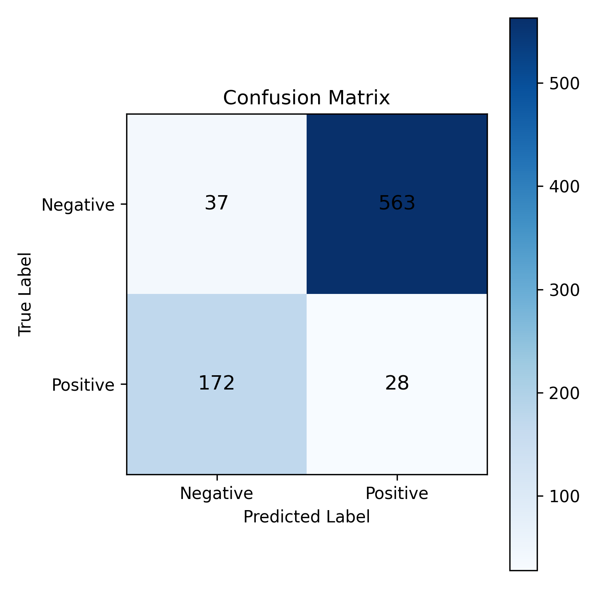

# HW1 — Dress Detection with Template Matching

An experimental computer vision pipeline for **binary dress detection** in Fashionpedia images using classical, OpenCV-based template matching. This assignment investigates how well a small collection of garment templates generalizes to unseen images.

> Part of the **StyleMatch** computer vision coursework. This HW1 experiment is a dress detector, **not** a complete outfit recommendation system.

## Approach

1. **Dataset:** Load Fashionpedia annotations (`detection-datasets/fashionpedia`) and identify the dress category (`category ID = 10` in the code).
2. **Preprocessing:** Convert images to grayscale and resize to **256 × 256** pixels.
3. **Templates:** Crop the largest annotated dress from selected training images to construct **10 templates**.
4. **Detection:** Apply template matching across sliding windows; use match-score and area thresholds to decide whether a dress is present.
5. **Evaluation:** Compare binary predictions against image-level labels using precision, recall, F1, accuracy, and a confusion matrix. Tune thresholds on validation data before evaluating on test data.

## Data and experiments

| Setting | Value |
| --- | --- |
| Dataset | Fashionpedia |
| Task | Dress present / absent |
| Input image size | 256 × 256, grayscale |
| Templates | 10 |
| Validation examples | 200 positive, 600 negative |
| Test examples | 200 positive, 600 negative |
| Parameter sweep | 4 match thresholds × 2 area thresholds × 3 stride ratios = 24 configurations |
| Selected match threshold | `0.50` |
| Selected area threshold | `0.30` |
| Selected stride ratio | `0.50` |

**Reproducibility note:** The preparation scripts load the Fashionpedia `train` split and select examples sequentially. The test preparation code skips the first 1,000 dataset examples, but this alone does **not** establish a formally disjoint train/validation/test split. Results should be interpreted as those reported for the original assignment, not as an independently verified benchmark.

## Results

The following values are taken from the submitted HW1 report; they have not been re-computed during this repository cleanup.

| Metric | Validation | Test |
| --- | ---: | ---: |
| Precision | 0.0483 | 0.0474 |
| Recall | 0.1400 | 0.1400 |
| F1 score | 0.0718 | 0.0708 |
| Accuracy | — | 0.0813 |

**Test confusion matrix:** TN = 37, FP = 563, FN = 172, TP = 28.



The experiment produced many false positives. The results illustrate the limitations of using a small set of rigid templates for garments that vary in scale, pose, texture, and background.

## Project structure

```text
HW1_Template_Matching/
├── README.md
├── requirements.txt
├── .gitignore
├── confusion_matrix.png
├── reports/
│   └── HW1-report.pdf
└── src/
    ├── check_dataset.py
    ├── prepare_split.py
    ├── prepare_templates.py
    ├── preprocessing.py
    ├── template_matching.py
    ├── evaluation.py
    ├── test_validation_thresholds.py
    ├── test_final_evaluation.py
    └── ... (additional checks and visualization scripts)
```

Generated data is intentionally excluded from version control under `data/`.

## Setup and usage

Install dependencies in a Python environment:

```bash
cd HW1_Template_Matching
python -m pip install -r requirements.txt
```

The scripts use relative paths such as `data/processed/...`; **run them from `HW1_Template_Matching/`**, not from `src/` or the repository root.

```bash
python src/prepare_templates.py
python src/prepare_split.py val
python src/prepare_split.py test
python src/test_validation_thresholds.py
python src/test_final_evaluation.py
```

`prepare_templates.py` and `prepare_split.py` download Fashionpedia on first use. These commands describe the workflow found in the source; they have **not** been re-run end to end as part of the documentation update. Additional scripts in `src/` provide dataset checks, sanity tests, and visualization.

## Limitations

- Only 10 templates are used, which cannot capture the visual variability of dresses.
- Template matching is sensitive to scale, pose, occlusion, and background clutter.
- The reported test F1 is low, with a particularly high false-positive count.
- The dataset selection logic does not provide a rigorous, documented disjoint split.

## Report

[Read the HW1 assignment report](reports/HW1-report.pdf).
