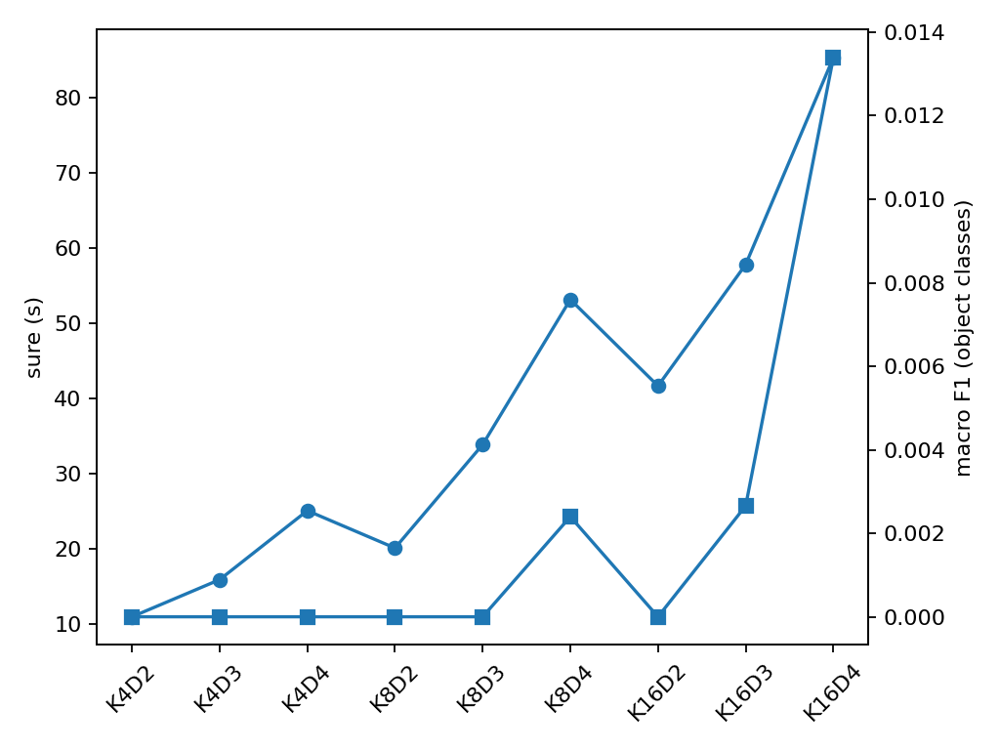
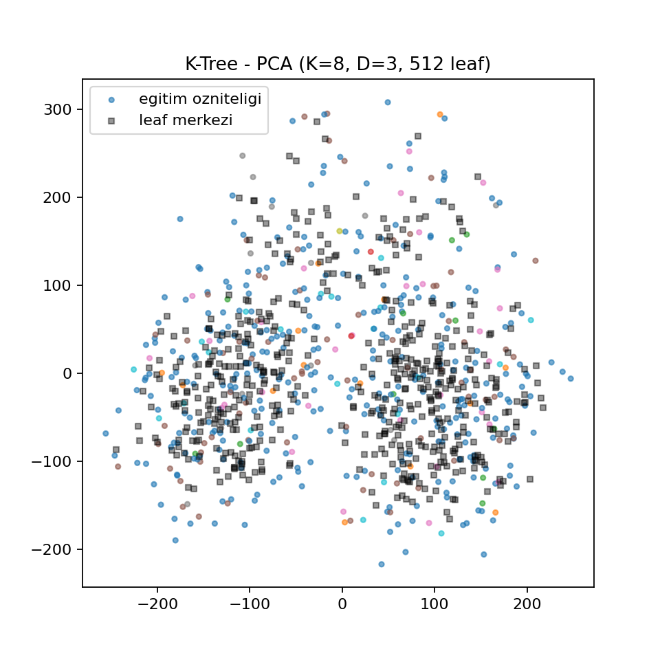
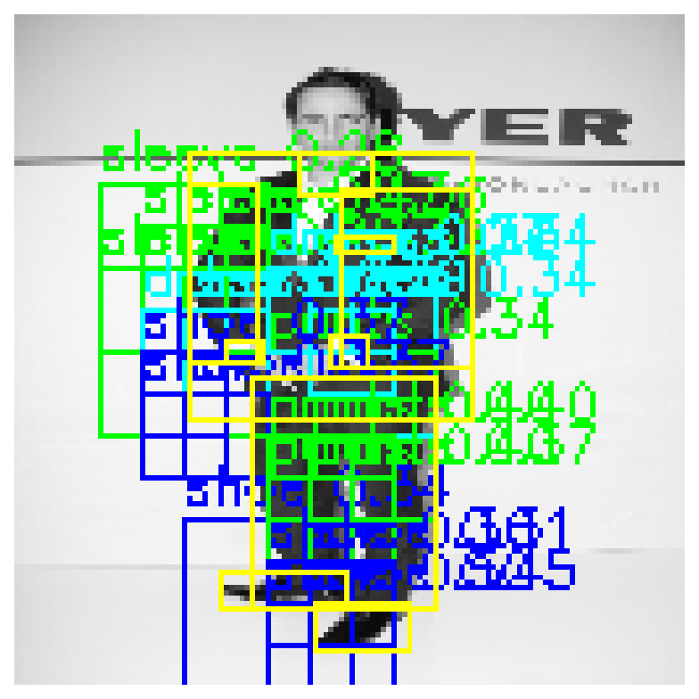
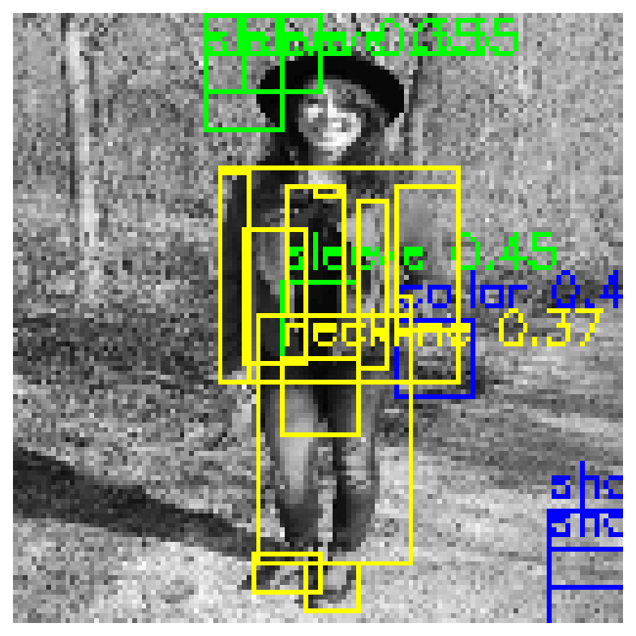

# HW3 — Fashion Object Detection with SIFT and Hierarchical K-Means

An experimental computer-vision pipeline for **fashion-object classification in sliding windows**, using **SIFT descriptors** and a hierarchical **K-Means tree (K-tree)**. Developed for BIL468/BIL587 Computer Vision coursework.

> **Research outcome:** This method performed poorly on object classes. The reported 92.1% test accuracy is dominated by background windows; **object-class macro F1 was 0.0072**. This repository documents the implementation, experiments, and limitations rather than presenting the model as a production-ready detector.

## Approach

1. **Dataset:** Load [`detection-datasets/fashionpedia`](https://huggingface.co/datasets/detection-datasets/fashionpedia). Select the ten most frequent categories and construct image-level training, validation, and test samples.
2. **Features:** Resize images to **128 × 128 grayscale** and extract **128-dimensional SIFT descriptors**. Training descriptors are assigned labels using their keypoint positions relative to annotated boxes.
3. **Training:** Build a hierarchical K-Means tree with branching factor **K** and depth **D**. Aggregate class counts at leaves for descriptor-based voting.
4. **Detection:** Extract SIFT once per image, then evaluate windows of **128, 64, 32, and 16 pixels** at half-window strides. Window predictions use leaf votes and classification thresholds.
5. **Evaluation:** Assign window ground truth using **IoU ≥ 0.3** and report confusion matrices, per-class precision/recall/F1, and object-class macro metrics.

The reported experiment uses frequency-normalized voting (`norm_power=1.0`) and minimum leaf support (`min_leaf_support=5`). **Implementation caveat:** `detect_eval.py` currently passes `norm_power=0.5` by default, overriding the `class_probs` default in the locally modified `ktree.py`. Therefore, running the commands below without explicit parameter alignment is **not guaranteed to reproduce the report's results**. The source code is intentionally left unchanged during this documentation cleanup.

## Dataset and evaluation protocol

The academic report records:

| Split | Images | SIFT descriptors |
| --- | ---: | ---: |
| Train | 10,000 | 966,435 |
| Validation | 654 | 63,916 |
| Test | 693 | 70,300 |

Categories: sleeve, shoe, neckline, pocket, dress, top/t-shirt/sweatshirt, pants, collar, zipper, jacket (plus background during window evaluation).

**Important split qualification:** Training and validation images were sampled without overlap from Fashionpedia's training split. The test set contains **590 images from the official validation split plus 103 previously unused training-split images** to satisfy the zipper category quota. Consequently, these results are **not a pure official Fashionpedia validation-set benchmark**.

## Reported results

Validation hyperparameter search tested `K ∈ {4, 8, 16}` and `D ∈ {2, 3, 4}` and selected the configuration with the highest object-class macro F1.

| Selected setting | Value |
| --- | ---: |
| Branching factor K | 16 |
| Depth D | 4 |
| Theoretical leaf count | 65,536 |
| Training time | ~85.4 s |
| Validation macro F1 (objects only) | 0.013 |

**Reported test metrics** (`IoU=0.3`, margin `0.08`, minimum object probability `0.20`):

| Metric | Value |
| --- | ---: |
| Accuracy | 0.921 |
| Macro precision (excluding background) | 0.0085 |
| Macro recall (excluding background) | 0.0068 |
| **Macro F1 (excluding background)** | **0.0072** |

Approximately **94% of evaluated test windows were background**. High overall accuracy therefore does not indicate effective object detection: most true object windows were predicted as background. The report also notes overlapping descriptor clusters in PCA space and limited gains from larger trees despite higher computational cost.

## Experiment visualizations

### Hyperparameter sweep



### PCA projection



PCA is used here **for visualization**, not as a dimensionality-reduction stage in the main training pipeline.

### Qualitative examples

| Relatively better example | Poor example |
| --- | --- |
|  |  |

“Good” is relative to the model's weak overall performance; the examples are not evidence of reliable detection.

## Installation

Python 3.11+ is a reasonable starting point; exact package versions and end-to-end compatibility have **not been validated** in a clean environment.

```bash
cd HW3
python -m venv .venv
source .venv/bin/activate
python -m pip install -r requirements.txt
```

The Fashionpedia dataset is downloaded using the Hugging Face `datasets` library during data preparation. Internet access and sufficient local storage are required for a fresh run.

## Running the experiments

**Run from inside `HW3/`**: scripts read and write several files relative to the current working directory.

```bash
python data_prep.py
python tune_pca.py --iou 0.3
python detect_eval.py --iou 0.3
python show_test.py --iou 0.3
```

- `data_prep.py` creates `features.npz`, `raw_images.pkl`, and `split_info.pkl`.
- `tune_pca.py` sweeps K/D combinations, saves the selected `ktree_model.pkl`, and generates `hyperparam_sweep.png` and `ktree_pca.png`.
- `detect_eval.py` evaluates the saved model on the test images.
- `show_test.py` produces example visualizations.
- `train.py` can also train a single K-tree (default `K=16`, `D=4`) after data preparation.

**Reproducibility note:** The numbers above are **reported historical results**, not metrics independently rerun for this README. Local changes to `ktree.py` and the normalization default mismatch noted earlier can affect outcomes. Large generated artifacts are intentionally excluded from version control.

## Files

| File | Purpose |
| --- | --- |
| `data_prep.py` | Fashionpedia sampling and labeled SIFT extraction |
| `ktree.py` | Hierarchical K-Means tree, leaf statistics, class voting |
| `train.py` | Single-configuration training and model serialization |
| `tune_pca.py` | Hyperparameter sweep and PCA visualization |
| `detect_eval.py` | Multi-scale sliding-window detection and evaluation |
| `show_test.py` | Qualitative test examples |
| `metrics.py` | NumPy-based classification metrics and PCA helpers |
| `plot_pca_clean.py` | Optional local plotting utility; not required for the main pipeline |

Generated `*.npz` and `*.pkl` data/model artifacts are not distributed in this repository. The selected small PNG visualizations are intended to be tracked alongside this README.

## Academic report

See the [full HW3 report](reports/HW3-report.pdf) for the hyperparameter table, per-class test results, confusion matrix, sampling details, and discussion of limitations.
